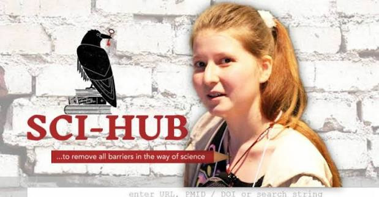

# Sci-Hub y Alexandra Elbakyan: la ‘Defensa de Dama’ de la Robin Hood de la ciencia

*Este artículo es parte de nuestro nuevo newsletter exclusivo Peer Review de ciencia y academia, el que ahora se comparte para todo público.*  
<https://interferencia.cl/articulos/sci-hub-y-alexandra-elbakyan-la-defensa-de-dama-de-la-robin-hood-de-la-ciencia>

    Si he visto más lejos, ha sido poniéndome a hombros de gigantes”. Esta frase de Isaac Newton, aunque no originaria de él, se refiere a que en el ámbito científico las personas que desarrollan investigación y/o elaboran teorías, requieren primero conocer -como ha detallado en su libro Creativity, Mihaly Csikszentmihalyi- la investigación y las teoría previas. La ciencia humana se debe entender antes como un proceso colectivo, más que sólo como iniciativas individuales aisladas o solitarias.

 
    
    
En este contexto, cuando una científica o académica empieza su proceso de indagación pretendiendo arribar a nuevos hallazgos, debe primero revisar las publicaciones, a menudo presentadas como Artículos de Investigación Científica (AIC) -aunque más conocidos como papers- que se hallan registrados desde hace un cuarto de siglo en repositorios como ScienceDirect, ProQuest, EBSCO, JStor entre otras decenas o centenares de bases de datos.

---

## ¿Quién es la responsable?

Hay, eso sí, una enorme traba: para acceder a dichos hombros de gigantes, la investigadora debe disponer de un acceso que a menudo proporcionan las universidades, que gastan decenas o centenares de miles de dólares por el permiso a aquellos repositorios. De no disponerse de aquellos “peajes pagados”, la investigadora se encontrará con un muro de pago, que a menudo le cobrará entre USD 30 y 50 por cada AIC que requiera leer para desarrollar su investigación: incluso si el paper es de ella misma (!), porque las personas que trabajan en ciencia no reciben dinero desde las editoriales por sus publicaciones.

Si se asume que cualquier indagación académica, por específica y acotada que sea, suele demandar la lectura de varias docenas de AIC como bibliografía, el costo de la investigación puede partir fácilmente por el valor de un automóvil nuevo nada de barato.

En el  siglo 21 la concomitancia de la disponibilidad, habitualmente en formato PDF, de los papers, y el tremebundo muro de pago, movilizó que en muchas partes del planeta, las académicas se prestaran bajo cuerdas sus claves de acceso, levantaran iniciativas como, “Te bajo este PDF” (donde otras académicas ingresaban con sus datos a sus propias bases y descargaran el PDF deseado por otra persona), entre otros procedimientos que pretendían bypassear este escollo.

Entonces, en 2011, una investigadora joven de **Kazajistán, llamada Alexandra Asanova Elbakyan** (nacida en 1988) montó la que luego sería la iniciativa pirata más renombrada -y más perseguida por las editoriales científicas y las bases de datos pagas- para el acceso a los hombros de gigantes: Sci-Hub.

## ¿Qué es realmente?

Sci-Hub no es una plataforma de pirateo de AIC que dispone de decenas de millones de papers que se encuentran tras los muros de pago de las editoriales-monstruo de la ciencia contemporánea. Es por lo contrario, un espacio para la ciencia abierta. Y para la académica que inicia su investigación basta con ingresar en la página principal del sitio, el link al artículo o su identificación con una cifra que individualiza cada paper en el mundo que se llama DOI.

La académica basta que copie y pegue alguna de esas dos direcciones, apriete ENTER y voilá, el paper ya está en sus manos. Se estima que cada día, unas 30.000 investigadoras o investigadores en el planeta usan **Sci-Hub** y un reporte de Science de 2016 señalaba que incluso la plataforma era usada por académicas y académicos de las más empingorotadas universidades de la *Ivy Leage* que encontraban más expedito pegar en el buscador de Sci-Hub el link al paper requerido que ingresar a las cuantiosas bases de datos que les proporcionaba su “U”, por todo lo engorroso que significaba hacer muchos clicks y licenciarse en cada repositorio.

Obviamente las grandes editoriales científicas han iniciado hace años una serie de demandas legales, requerimientos de bloqueo de páginas y la persecución legal de Alexandra Elbakyan, que ahora vive en Rusia; tal como hicieron con Aaron Swartz -el programador estadounidense que recolectó millones de AIC desde JStor y los hizo públicos y que luego de ser demandado Magistratura Federal de los Estados Unidos por robo de información se suicidó en enero de 2013-, una década antes.

## ¿Ha tenido impacto?

Hasta ahora la campaña anti-Sci-Hub ha tenido escasos efectos, como que en algunos países europeos y los Estados Unidos se bloquee el sitio, o demandas infructuosas por lograr que Elbakyan se presente a juicio en Estados Unidos. Pero hace algunos meses esa situación cambió.

Entonces, en 2011, una investigadora joven de Kazajistán, llamada Alexandra Elbakyan (nacida en 1988) montó la que luego sería la iniciativa pirata más renombrada -y más perseguida por las editoriales científicas y las bases de datos pagas- para el acceso a los hombros de gigantes: Sci-Hub.
De improviso Sci-Hub dejó de subir nuevos papers.

Solo como nota, para entender la vertiginosidad del aumento del volumen de estas publicaciones, se estima que aparecen tres papers nuevos en el mundo por cada minuto que pasa [de hecho, en los estimados cuatro minutos que usted se ha tomado para leer hasta este punto el presente Newsletter, se han ya publicado doce nuevos papers en el planeta].

## ¿Por qué haría esto Alenxandra?

¿Por qué Alexandra Elbakyan parece haber cedido, dejando de subir papers a su plataforma? Porque ha detectado que tiene una posibilidad de ganar la guerra del acceso a los AIC.

De acuerdo con un reportaje y entrevista realizado por Tom Bartlett para The Chronicle of Higher Education en junio de este 2021:

“La última demanda, presentada en India por tres editoriales académicas, incluida Elsevier, solicita al Tribunal Superior de Delhi que bloquee el acceso a Sci-Hub en todo el país. Mientras el caso está pendiente, el tribunal ordenó a Sci-Hub que deje de cargar documentos en su base de datos. La orden no es inusual; lo sorprendente es que Elbakyan haya cumplido. Tiene un historial de ignorar fallos legales y el tribunal indio no tiene poder sobre las actividades de Sci-Hub en otros países. Entonces, ¿por qué ha elegido, en este momento, ceder? Una razón es que Elbakyan cree que tiene una oportunidad de ganar el caso, y sus probabilidades podrían mejorar si sigue las reglas. “Quiero que la corte india finalmente apoye el acceso gratuito a la ciencia”, dijo. Si eso sucediera, marcaría una victoria significativa para Sci-Hub, con repercusiones probablemente más allá de la India. La victoria sigue siendo una posibilidad remota, pero Elbakyan cree que vale la pena la molestia y el gasto. Ni siquiera se molestó en impugnar las dos demandas en los Estados Unidos”.

No es poco, porque, tal como Dunu Roy, especialista y ecologista de la India, detalla en un reciente texto para The Wire, traducido por Boletín SciELO-México: “Teniendo en cuenta que la India es el tercer productor mundial de artículos científicos, los investigadores indios descargan cada año unos siete millones de artículos de estos sitios web. A una media de 40 dólares por artículo, esto representa una pérdida anual de unos 300 millones de dólares para las empresas editoriales, sólo en la India, en comparación con los 200 millones de dólares que los institutos de investigación indios gastan en suscripciones a revistas y artículos de pago. Incluso los estudiantes universitarios estadounidenses son aficionados a estos sitios. ¿No es de extrañar que las empresas mundiales estén preocupadas?”.

No solo eso, ya hay muchas y muchos abogados de la India que han prestado apoyo a Elbakyan para que pueda ganar el caso, así como apoyos más o menos directos de la comunidad científica del tercer país más generador de papers del mundo. La batalla está en desarrollo y sus resultados pueden significar un punto de inflexión en cómo se entiende hoy la frase de Newton, y los hombros de gigantes.

## La propuesta de Anthrop\c 

Finalmente Alenzandra conserva el códice que indica en que lugar del mundo están lamacenada (literalmente) millones de copias de los chunks del has de cada uno de los PDF que los usuarios han compartido en esta red.

Los dueños de **Claude**  le han ofrecido a Alexandra que su acervo pase a ser parte del material que se utiliza para entrenal los modelos sumados a la gran catidad (casi todos) los libros que escanearon en Costa Rica en 2026 y que conforme se escaneaban en papel se utilizaban para quemar en calderas de vapor para generar parte de la energía que se gastó en hacerles *OCR* e indexalos.
A cambio el equipo de abogados de la empresa le ofrece garantias de eliminación de todas las demandas que se han presentado contra ella. 

Para complementar y superar las limitaciones de Sci-Hub —cuya base de datos dejó de actualizarse masivamente tras los litigios judiciales de 2020—, Alexandra Elbakyan ha impulsado Sci-Net, una red social científica descentralizada, junto con Sci-Bot, un motor de inteligencia artificial propio. 
